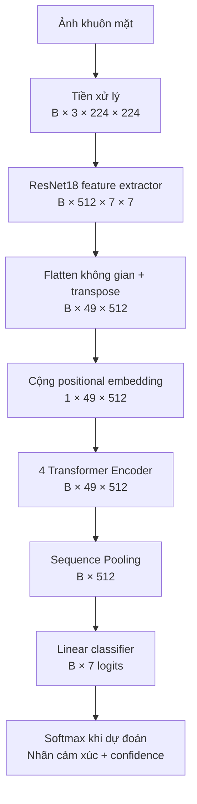

# Kiến trúc model nhận diện cảm xúc khuôn mặt

Tài liệu mô tả **CCT_ResNet** đang được triển khai trong dự án:
**ResNet18 → Transformer Encoder → Sequence Pooling → Linear classifier**.
Model phân loại ảnh khuôn mặt thành 7 cảm xúc theo cấu hình FER2013.

Nội dung được đối chiếu với mã nguồn và checkpoint cục bộ ngày 24/11/2026.
Các thiết lập huấn luyện bên dưới mô tả pipeline hiện tại; chúng không xác nhận
lịch sử huấn luyện của checkpoint được sao chép từ dự án trước.

## 1. Tổng quan

| Thuộc tính | Giá trị hiện tại |
|---|---|
| Lớp model | `CCT_ResNet` |
| Backbone / tokenizer | ResNet18, bỏ Average Pooling và Fully Connected cuối |
| Đầu vào | Tensor số thực `B × 3 × 224 × 224`, đã chuẩn hóa |
| Số token | `49`, tương ứng bản đồ đặc trưng `7 × 7` |
| Số chiều mỗi token | `512` |
| Positional embedding | Học được, kích thước `1 × 49 × 512` |
| Transformer Encoder | `4` lớp |
| Attention heads mỗi lớp | `8`, mỗi head có `64` chiều |
| Feed-forward network | `512 → 2048 → 512`, activation GELU |
| Tổng hợp chuỗi | Sequence Pooling với trọng số học được |
| Bộ phân loại | `Linear(512, 7)` |
| Đầu ra của model | Logits `B × 7` |
| Tổng số tham số | **23.815.240** |

`B` là số ảnh trong một batch. Tensor ảnh dùng thứ tự
`batch × channels × height × width`; chuỗi token dùng
`batch × sequence_length × embedding_dim`.

Đây là biến thể kết hợp CNN và Transformer theo cách tổ chức của CCT.
Tokenizer trong triển khai này là phần trích xuất đặc trưng ResNet18,
gồm stem và bốn residual stage.

## 2. Sơ đồ xử lý



Trong ứng dụng webcam hoặc ảnh, OpenCV Haar Cascade phát hiện và cắt khuôn mặt
trước bước tiền xử lý. Bộ phát hiện này nằm ngoài `CCT_ResNet`.
Mỗi khuôn mặt được đưa qua bộ phân loại riêng.

## 3. Đầu vào và tiền xử lý

Pipeline dự đoán trong `EmotionRecognizer.predict()` thực hiện:

1. Nhận ảnh mặt OpenCV có thứ tự màu BGR.
2. Chuyển BGR sang RGB trước khi xử lý bằng PIL/torchvision.
3. Resize về `224 × 224`.
4. Chuyển thành ảnh xám và lặp thành 3 kênh.
5. Chuyển thành tensor; với ảnh `uint8`, giá trị pixel được đưa về `[0, 1]`.
6. Chuẩn hóa theo thống kê ImageNet:
   `mean = (0.485, 0.456, 0.406)`, `std = (0.229, 0.224, 0.225)`.
7. Thêm chiều batch và chuyển tensor sang thiết bị tính toán.

Công thức chuẩn hóa tại kênh `c`:

$$
x'_c = \frac{x_c - \mu_c}{\sigma_c}
$$

Ba kênh ảnh xám giống nhau trước chuẩn hóa. Sau chuẩn hóa, giá trị giữa các
kênh khác nhau do mean/std của từng kênh khác nhau.

`forward()` nhận tensor đã xử lý; bản thân model không resize, chuyển màu
hay chuẩn hóa ảnh. Validation và test dùng các phép biến đổi xác định tương ứng,
còn train bổ sung augmentation.

## 4. ResNet18 tokenizer

### Thành phần và kích thước tensor

`ResNetTokenizer` khởi tạo ResNet18 từ torchvision và lấy:

```python
self.feature_extractor = nn.Sequential(*list(resnet.children())[:-2])
```

Phần giữ lại gồm convolution đầu vào, BatchNorm, ReLU, MaxPool và `layer1`
đến `layer4`. Average Pooling và bộ phân loại ImageNet gốc được bỏ.

| Thành phần | Cấu hình chính | Kích thước đầu ra |
|---|---|---|
| Input | Ảnh 3 kênh | `B × 3 × 224 × 224` |
| Conv1 + BN + ReLU | Conv `7 × 7`, stride 2, padding 3, 64 kênh | `B × 64 × 112 × 112` |
| MaxPool | Kernel `3 × 3`, stride 2, padding 1 | `B × 64 × 56 × 56` |
| Layer1 | 2 BasicBlock, 64 kênh | `B × 64 × 56 × 56` |
| Layer2 | 2 BasicBlock, 128 kênh | `B × 128 × 28 × 28` |
| Layer3 | 2 BasicBlock, 256 kênh | `B × 256 × 14 × 14` |
| Layer4 | 2 BasicBlock, 512 kênh | `B × 512 × 7 × 7` |
| Flatten + transpose | Gộp hai chiều không gian thành chuỗi | `B × 49 × 512` |

Mỗi BasicBlock có hai convolution `3 × 3` và một nhánh residual.
Block đầu của layer2, layer3 và layer4 giảm kích thước bằng stride 2;
nhánh residual dùng convolution `1 × 1` cùng BatchNorm để khớp kích thước.

Residual connection cho phép cộng đầu vào với đặc trưng đã biến đổi:

$$
y = \operatorname{ReLU}\bigl(F(x) + S(x)\bigr)
$$

`S(x)` là nhánh identity hoặc projection.

### Chuyển bản đồ đặc trưng thành token

```python
tokens = feature_map.flatten(2).transpose(1, 2)
```

Từ bản đồ `512 × 7 × 7`, model tạo 49 token, mỗi token có 512 chiều.
Một token tương ứng một vị trí trên bản đồ đặc trưng sâu. Các vùng ảnh ảnh hưởng
đến những token này có thể chồng lấn qua các convolution.

Backbone giảm kích thước không gian theo hệ số 32 với đầu vào chuẩn.
Điều này giữ chuỗi attention ngắn, đồng thời có thể làm mất các chi tiết
biểu cảm nhỏ.

## 5. Positional embedding

Model khai báo:

```python
self.positional_emb = nn.Parameter(torch.zeros(1, 49, embed_dim))
```

Với cấu hình hiện tại, tensor có `49 × 512 = 25.088` tham số. Nó được cộng
vào chuỗi token và broadcast theo chiều batch:

$$
X_0 = T + P,\qquad
T \in \mathbb{R}^{B \times 49 \times 512},\quad
P \in \mathbb{R}^{1 \times 49 \times 512}
$$

Embedding này giúp attention sử dụng thông tin về thứ tự các vị trí trên
lưới `7 × 7` đã flatten.

Constructor khởi tạo embedding bằng zero. Pipeline `train()` khởi tạo lại bằng
phân phối chuẩn có độ lệch chuẩn `0.02`. Khi nạp checkpoint, giá trị được lưu
thay thế giá trị khởi tạo. Model chưa có cơ chế nội suy positional embedding.

## 6. Transformer Encoder

Chuỗi token đi qua **4 encoder liên tiếp**, mỗi encoder giữ nguyên kích thước
`B × 49 × 512`.

| Thiết lập mỗi encoder | Giá trị |
|---|---|
| `d_model` | `512` |
| `nhead` | `8` |
| Số chiều mỗi head | `512 / 8 = 64` |
| `dim_feedforward` | `2048` |
| Activation | GELU |
| `batch_first` | `True` |
| `norm_first` | `False`, dùng Post-LN |
| Dropout trong pipeline train | `0.1` |
| Dropout mặc định của constructor | `0.0` |
| LayerNorm cuối toàn bộ stack | Không khai báo |

### Multi-head self-attention

Mỗi token tạo query, key và value qua các phép chiếu tuyến tính.
Trong mỗi head:

$$
\operatorname{Attention}(Q,K,V)
= \operatorname{softmax}\left(\frac{QK^\top}{\sqrt{64}}\right)V
$$

Softmax được tính trên các vị trí key. Mỗi head có ma trận attention `49 × 49`
cho mỗi ảnh; kết quả 8 head được ghép lại và chiếu về 512 chiều.
Nhờ đó, mỗi vị trí có thể kết hợp thông tin từ toàn bộ các vị trí khác.

### Feed-forward, residual và LayerNorm

Feed-forward network được áp dụng riêng cho từng token:

```text
Linear(512, 2048) → GELU → Dropout → Linear(2048, 512)
```

Do `norm_first=False`, thứ tự một encoder là:

$$
U = \operatorname{LayerNorm}_1
\left(X + \operatorname{Dropout}_1(\operatorname{MHA}(X))\right)
$$

$$
Y = \operatorname{LayerNorm}_2
\left(U + \operatorname{Dropout}_2(\operatorname{FFN}(U))\right)
$$

`FFN` đã bao gồm dropout giữa hai lớp Linear. Khi gọi `eval()`, các lớp
dropout bị vô hiệu hóa.

## 7. Sequence Pooling

`SeqPool` tổng hợp 49 token thành một vector 512 chiều. Lớp `Linear(512, 1)`
chấm điểm từng token; softmax được áp dụng trên chiều chuỗi:

$$
s_i = w^\top x_i + b,\qquad
a_i = \frac{\exp(s_i)}{\sum_{j=1}^{49}\exp(s_j)},\qquad
z = \sum_{i=1}^{49} a_i x_i
$$

| Bước | Kích thước |
|---|---|
| Đầu vào từ Transformer | `B × 49 × 512` |
| Điểm và trọng số pooling | `B × 49 × 1` |
| Tổng hợp có trọng số | `B × 512` |

Model không thêm token `[CLS]`. Trọng số pooling được tính riêng cho từng ảnh.
Các token đã trao đổi thông tin qua Transformer nên trọng số này không đủ để
kết luận trực tiếp model đang chú ý vào một bộ phận khuôn mặt cụ thể.

## 8. Bộ phân loại và nhãn đầu ra

Lớp cuối là `Linear(512, 7)`, trả về logits `B × 7`.
`EmotionRecognizer.predict()` áp dụng softmax rồi chọn lớp có xác suất cao nhất.

| Chỉ số | Nhãn | Ý nghĩa |
|---|---|---|
| 0 | Angry | Giận dữ |
| 1 | Disgust | Ghê tởm |
| 2 | Fear | Sợ hãi |
| 3 | Happy | Vui vẻ |
| 4 | Neutral | Trung tính |
| 5 | Sad | Buồn |
| 6 | Surprise | Ngạc nhiên |

Thứ tự này khớp `ImageFolder` sắp xếp tên thư mục theo bảng chữ cái.
`confidence` hiển thị trong ứng dụng là xác suất softmax lớn nhất;
dự án chưa có bước hiệu chỉnh xác suất.

## 9. Phân bố tham số

Các giá trị được đếm từ `model.parameters()`, không bao gồm buffer như
running mean/variance của BatchNorm.

| Thành phần | Số tham số |
|---|---:|
| ResNet18 tokenizer | 11.176.512 |
| Bốn Transformer Encoder | 12.609.536 |
| Positional embedding | 25.088 |
| Sequence Pooling | 513 |
| Classifier | 3.591 |
| **Tổng** | **23.815.240** |

Mỗi encoder có 3.152.384 tham số. Transformer chiếm khoảng 52,95% tổng số
tham số, tokenizer chiếm khoảng 46,93%.
Với FP32, riêng tham số cần khoảng 90,85 MiB; bộ nhớ khi chạy còn bao gồm
buffer, activation và, khi train, gradient cùng trạng thái optimizer.

Tất cả tham số đều được phép cập nhật trong pipeline huấn luyện hiện tại.
Backbone không bị freeze.

## 10. Cấu hình huấn luyện hiện tại

### Khởi tạo và tối ưu

| Thiết lập | Giá trị mặc định |
|---|---|
| Epochs / batch size | `50` / `64` |
| Backbone khởi tạo từ ImageNet | Có, trừ khi chọn `pretrained=False` hoặc `--no-pretrained` |
| Dropout Transformer | `0.1` |
| Optimizer | AdamW |
| Learning rate tokenizer | `1e-5` |
| Learning rate phần còn lại | `5e-4` |
| Weight decay | `1e-4` |
| Scheduler | CosineAnnealingLR, `T_max = epochs` |
| Gradient clipping | Norm tối đa `1.0` |
| Focal gamma / label smoothing | `2.0` / `0.05` |
| Seed | `42` |

Loss trong mã nguồn là:

$$
\mathcal{L}
= \frac{1}{B}\sum_{n=1}^{B}
(1-p_{n,y_n})^\gamma
\operatorname{CE}_{\mathrm{smooth}}(\ell_n,y_n)
$$

`p` là softmax của logits `ℓ`. Xác suất của nhãn đúng trong hệ số focal được
tính từ cross-entropy không smoothing; hệ số này nhân với cross-entropy có
label smoothing. Loss hiện không dùng trọng số riêng cho từng lớp.

### Augmentation và curriculum

Train dùng Random Horizontal Flip và Random Rotation tối đa 10 độ, sau đó
Random Erasing trên tensor đã chuẩn hóa.

| Trạng thái | MixUp | Xác suất Random Erasing |
|---|---|---|
| Ban đầu | Tắt | `0.1` |
| Sau khi best validation accuracy đạt ít nhất `0.5` | Bật, `alpha = 0.2` | `0.5` |

Curriculum được kiểm tra ở đầu mỗi epoch dựa trên kết quả validation đã có.
Sau khi bật, chế độ này được giữ cho các epoch tiếp theo. Khi MixUp hoạt động,
loss và train accuracy được tính theo trọng số hai nhãn.

### Validation và chọn checkpoint

Nếu tồn tại `val/`, chương trình dùng trực tiếp tập này. Nếu không, chương trình
tách 10% dữ liệu trong `train/` làm validation theo lớp với seed 42.
Các augmentation ngẫu nhiên chỉ áp dụng cho tập train.

Checkpoint được lưu khi validation accuracy tốt hơn mức tốt nhất trước đó.
Tập `test/` chỉ được notebook sử dụng để đánh giá cuối sau khi nạp checkpoint
tốt nhất. Pipeline ghi `history.csv`, `training.json` và file weights vào
thư mục output.

## 11. Checkpoint và inference

Checkpoint mặc định là `models/cct_resnet_fer2013_best.pth`, có định dạng raw
`CCT_ResNet.state_dict()`. Loader dùng
`torch.load(..., map_location="cpu", weights_only=True)` rồi
`load_state_dict(..., strict=True)` trước khi chuyển model sang thiết bị đích.

Inference tạo `CCT_ResNet()` với `pretrained=False`, nên không tải weights
ImageNet. Trọng số checkpoint được nạp vào toàn bộ model.
Model chạy với `eval()` và `torch.inference_mode()`.

`device="auto"` chọn CUDA khi khả dụng, nếu không chọn CPU. Người dùng cũng
có thể chỉ định CPU, CUDA hoặc MPS khi thiết bị hỗ trợ.

Raw state dict không lưu đầy đủ cấu hình và lịch sử huấn luyện, chẳng hạn
số attention heads, dropout, optimizer, epoch hoặc cách chọn checkpoint.
Nạp thành công xác nhận tên và kích thước tensor tương thích với model hiện tại;
không tự xác nhận các thiết lập huấn luyện trước đây.

## 12. Ràng buộc và giới hạn

| Điểm cần lưu ý | Tác động |
|---|---|
| Positional embedding có 49 vị trí | Chuỗi từ backbone phải khớp 49 token; chưa hỗ trợ nội suy vị trí hoặc độ dài động |
| Backbone luôn trả về 512 kênh | Thay `embed_dim` bằng giá trị khác cần bổ sung projection tương ứng |
| Embedding dimension phải chia hết cho số heads | Cấu hình hiện tại thỏa mãn `512 / 8 = 64` |
| Bản đồ đặc trưng cuối là `7 × 7` | Có thể hạn chế biểu diễn chi tiết biểu cảm nhỏ |
| Chuyển ảnh sang grayscale | Không giữ thông tin màu gốc |
| Mỗi frame được xử lý độc lập | Chưa khai thác chuyển động hoặc tổng hợp kết quả theo thời gian |
| Khuôn mặt được cắt bằng Haar Cascade | Chất lượng đầu vào phụ thuộc bộ phát hiện và vùng crop |
| Chưa có bước căn chỉnh landmark | Góc mặt và vị trí bộ phận khuôn mặt có thể thay đổi giữa các crop |
| Chưa hiệu chỉnh confidence | Phần trăm softmax không phải thước đo độ tin cậy đã được hiệu chỉnh |

Đầu vào chuẩn của dự án là `224 × 224`. Model không kiểm tra kích thước ảnh
trực tiếp; điều kiện ở bước cộng positional embedding là kích thước chuỗi
phải phù hợp. Đổi độ phân giải cần kiểm tra lại toàn bộ luồng tensor.

Accuracy, macro F1, tốc độ và bộ nhớ cần được đo trên dữ liệu và thiết bị cụ thể.
Chạy thành công với ảnh giả chỉ xác nhận luồng tính toán, không đánh giá
chất lượng nhận diện.

## 13. Kiểm chứng kiến trúc

Trong phiên phân tích, checkpoint cục bộ đã nạp thành công với `strict=True`.
Đầu vào giả `1 × 3 × 224 × 224` đi qua các khối với kích thước như mô tả
và cho đầu ra hữu hạn `1 × 7`. Số tham số đếm được là `23.815.240`.

Sau khi cài môi trường theo README và chạy từ thư mục gốc dự án, có thể dùng
đoạn Python sau để kiểm tra lại:

```python
from pathlib import Path

import torch

from fer.model import CCT_ResNet

model = CCT_ResNet().eval()
checkpoint = Path("models/cct_resnet_fer2013_best.pth")
state = torch.load(checkpoint, map_location="cpu", weights_only=True)
model.load_state_dict(state, strict=True)

with torch.inference_mode():
    logits = model(torch.zeros(1, 3, 224, 224))

print("Output shape:", tuple(logits.shape))  # (1, 7)
print("Finite:", torch.isfinite(logits).all().item())  # True
print("Parameters:", sum(p.numel() for p in model.parameters()))  # 23815240
```

## 14. Mã nguồn liên quan

| Tệp | Trách nhiệm |
|---|---|
| [model.py](../src/fer/model.py) | ResNetTokenizer, SeqPool và CCT_ResNet |
| [config.py](../src/fer/config.py) | Nhãn, kích thước ảnh, thống kê chuẩn hóa và cấu hình inference |
| [predictor.py](../src/fer/predictor.py) | Nạp checkpoint, tiền xử lý và dự đoán |
| [training.py](../src/fer/training.py) | DataLoader, augmentation, loss, train và evaluate |
| [app.py](../src/fer/app.py) | Phát hiện mặt, webcam, đọc ảnh và hiển thị kết quả |
| [Notebook CCT local](../notebooks/cct/fer2013-cct-resnet18-local.ipynb) | Gọi pipeline train, biểu đồ và đánh giá cuối trên test |
| [Định dạng weights](../models/README.md) | Cách cung cấp checkpoint tương thích |
